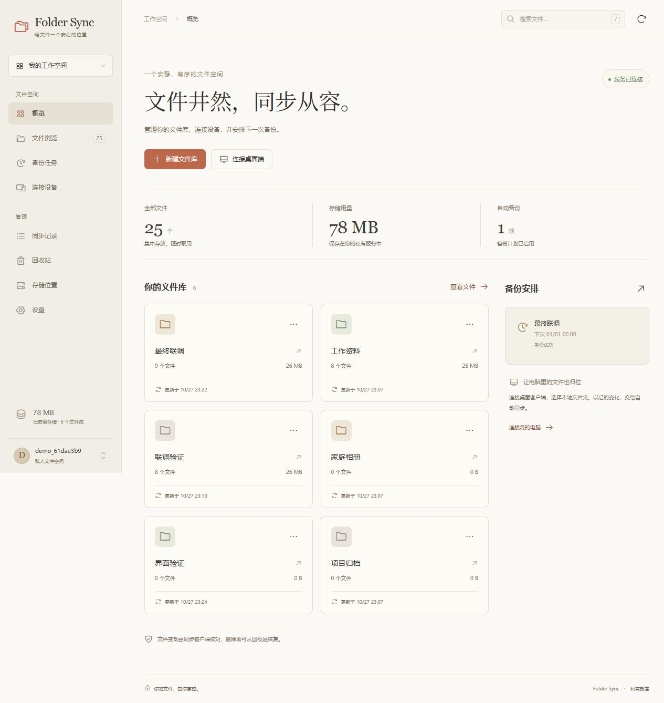
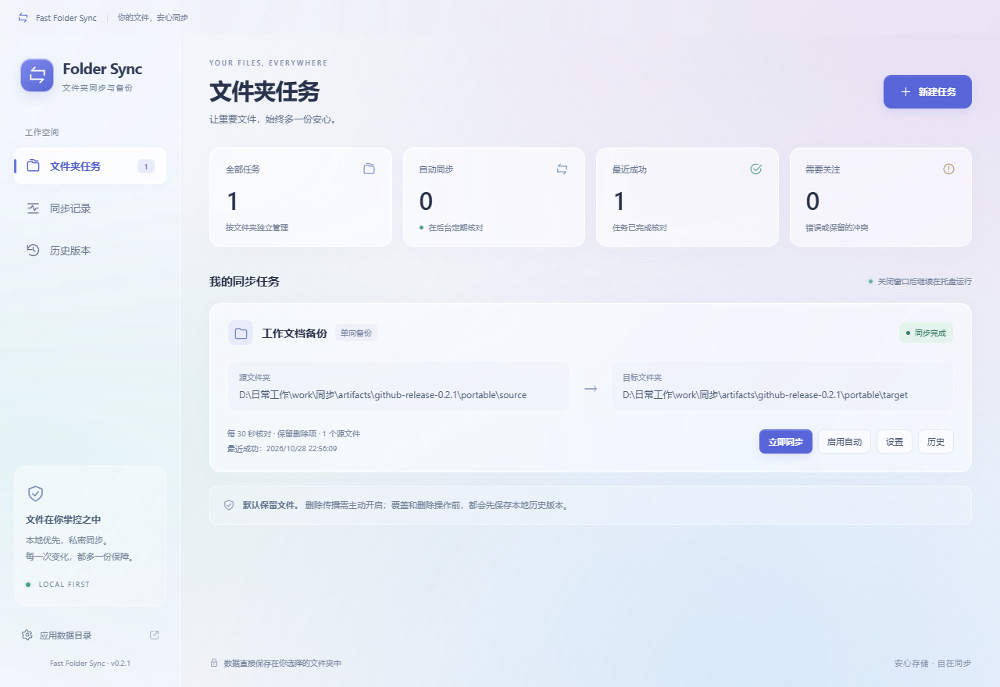

# Fast Folder Sync

通用文件夹备份与同步软件，包含独立桌面客户端和可私有部署的服务端。支持文档、照片、视频、代码及其他二进制文件。Windows 客户端采用浅色毛玻璃界面；服务端管理台采用暖白背景、陶土色按钮与衬线标题。

当前改造版本：**0.2.1**。基于 Apache-2.0 许可的 Fast Note Sync 客户端与服务端改造，上游来源见 [NOTICE](NOTICE.md)。

版本由根目录 `VERSION` 统一管理，执行 `npm run version:check` 核对两端版本；更新版本使用 `npm run version:set -- 0.2.1`。发布记录见 [CHANGELOG](CHANGELOG.md)，分支、标签和回滚流程见 [版本管理说明](docs/VERSIONING.md)。



## 功能

- 独立 Electron 桌面端，可选择任意文件夹，查看同步状态并在托盘后台运行。
- 本地、移动磁盘、已挂载网络目录之间的单向备份和双向同步。
- 多台电脑通过私有服务端同步同一个文件库。
- 完整 SHA-256 校验，新文件统一二进制传输，兼容旧文本资源。
- 覆盖前保存历史版本、保留冲突副本、排除规则，删除传播默认关闭。
- 服务端文件上传、下载、重命名、回收站恢复、设备令牌与备份计划。
- 本地磁盘、S3、OSS、R2、MinIO、WebDAV 备份目标，使用前需在服务配置中启用对应类型。

## 项目结构

| 路径 | 内容 |
| --- | --- |
| `fast-folder-sync/desktop/` | 独立桌面端、同步引擎和测试 |
| `fast-folder-sync/src/` | 保留的原始 Obsidian 插件源码 |
| `fast-folder-sync-service/web/` | 可编辑的通用文件管理台源码 |
| `fast-folder-sync-service/frontend/` | 前端生产资源，由 Go 服务嵌入 |
| `fast-folder-sync-service/internal/` | 服务接口、权限与同步业务 |
| `fast-folder-sync-service/compose.folder.yaml` | Docker 部署配方 |

## 桌面端开发

需要 Node.js 24 或更新版本。

```sh
cd fast-folder-sync/desktop
npm ci
npm run check
npm test
npm start
```

Windows 便携版构建：`npm run dist:win`。其他系统提供构建配置，需在对应机器验证。

## 服务端开发

需要 Go 1.26 和 Node.js 24。

```sh
cd fast-folder-sync-service/web
npm ci
npm test
npm run build
cd ..
go build -trimpath -o fast-folder-sync-service .
./fast-folder-sync-service run
```

Windows 可使用 `go build -trimpath -o fast-folder-sync-service.exe .` 后运行 `fast-folder-sync-service.exe run`。

浏览器打开 `http://127.0.0.1:9000/webgui/`，创建首个账户和文件库。在「连接设备」生成设备配置，再在桌面端新建任务，选择「Folder Sync 私有服务」，填写服务根地址、相同文件库名及设备令牌。

Docker 从源码构建：

```sh
cd fast-folder-sync-service
docker compose -f compose.folder.yaml up -d --build
```

详细说明：[桌面端](fast-folder-sync/docs/desktop.md)、[服务端](fast-folder-sync-service/README.folder.md)。

## 验证与限制

Windows 实测通过：桌面端 20 项测试、管理台 4 项测试、Go 核心 6 个包测试和 9 项真实服务跨端检查，覆盖两台客户端、大文件未采样区域修改、下载字节一致性、删除恢复和归档。桌面便携包实际窗口验证了备份、覆盖归档及恢复。

Linux 交付二进制仅交叉编译。Docker、第三方云存储、外部 OIDC 未在当前环境实测。Windows 包未签名。新控制台未重建旧管理员用户编辑器、Git 设置和高级 Stytch 页面，底层 API 保留。服务内核版本保留上游 3.6.1，产品改造版本为 0.2.1。

仓库不包含运行数据、测试账户、依赖目录及可执行交付包。桌面端与服务端的完整验证记录分别见 [桌面验证](fast-folder-sync/docs/desktop-validation.md) 和 [服务验证](fast-folder-sync-service/VALIDATION.folder.md)。


