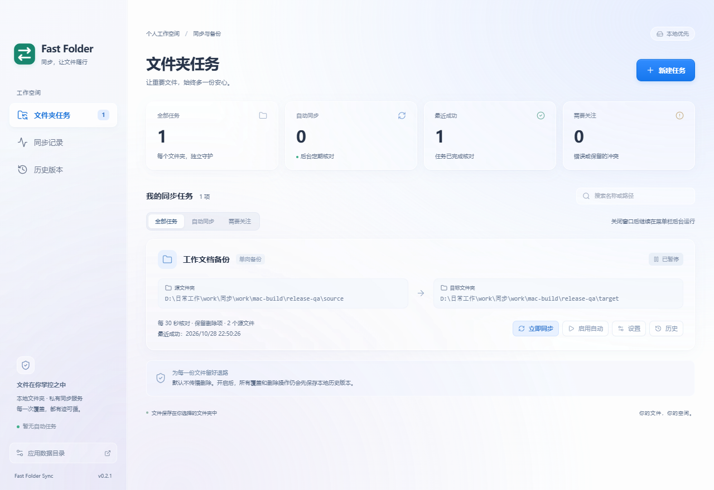
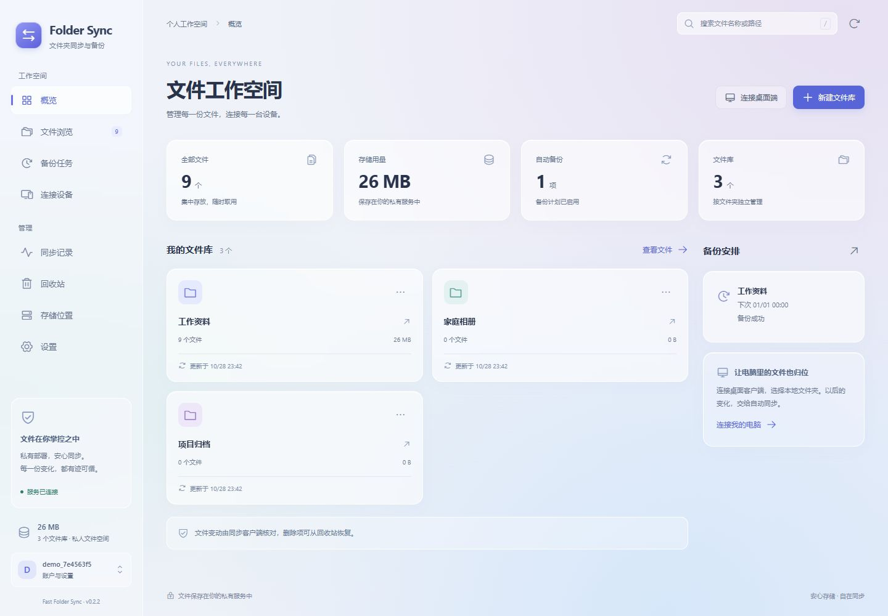

# Fast Folder Sync

**新增功能：Agent 记忆同步（Agent Sync）**——在原有文件同步与备份基础上，新增跨电脑、跨 Codex / Claude Code / ZCode / WorkBuddy 的个人记忆工作台。支持选择已有记忆与规则、项目关联、摘要整理和版本恢复。原首页、任务及功能入口保持不变，通过侧栏「Agent 记忆同步」进入新增功能。[Agent Sync 使用说明](docs/AGENT-SYNC.md)

通用文件夹备份与同步软件，包含独立桌面客户端和可私有部署的网页服务端。支持文档、照片、视频、代码及其他二进制文件，无需安装 其他软件。

当前版本：**0.3.0**。客户端与网页管理台统一采用蓝紫毛玻璃界面。

## 产品说明

### 适用场景

| 场景 | 使用方式 |
| --- | --- |
| 把工作文档备份到另一块磁盘 | 桌面端创建单向备份任务，无需部署服务端 |
| 电脑与移动磁盘、已挂载 NAS 目录保持一致 | 桌面端创建本地双向同步任务 |
| 多台电脑同步同一批文件 | 部署私有服务，各台电脑连接同一个文件库 |
| 在浏览器中管理文件和备份 | 通过网页管理台上传、下载、搜索文件，管理设备与备份计划 |

### 主要功能

- **文件夹任务**：自选源目录与目标位置，支持多个任务、定期自动同步、排除规则及托盘后台运行。
- **单向备份与双向同步**：本地目标支持两种模式；私有服务支持双向同步。NAS / SMB 目录需要先在操作系统中挂载。
- **文件保护**：覆盖前保存本地历史版本；同时修改时保留冲突副本；删除传播默认关闭，开启后仍会保存被删除文件的历史版本。
- **网页文件管理**：文件库、文件浏览、上传下载、重命名、同步记录及回收站恢复。
- **设备连接**：签发和撤销设备令牌，多台电脑连接相同文件库。
- **服务端备份**：全量归档、增量归档和镜像同步；支持本地磁盘、S3、OSS、R2、MinIO 与 WebDAV，存储类型需在服务配置中启用。
- **内容校验**：配套客户端与服务端使用完整 SHA-256，所有新文件统一二进制传输，兼容已有文本资源。

桌面端直接连接本地目录或 Folder Sync 私有服务；云存储作为服务端备份目标使用。

### 界面预览

**Windows 客户端**：蓝紫渐变背景、半透明导航、任务概览卡片与磨砂弹窗。


**Mac 客户端**：专属毛玻璃布局，随系统切换浅深主题，支持任务搜索、状态筛选和菜单栏后台运行。



Mac 配图为 Windows 环境中的布局预览。Mac 安装包的构建方式和验证范围见[使用说明](fast-folder-sync/docs/desktop-mac.md)。

**网页管理台**：与客户端统一配色、字体和卡片风格，提供文件概览、文件库、文件浏览、备份、设备和存储管理，适配桌面与手机浏览器。



<details>
<summary>查看手机浏览器界面</summary>


</details>

### 日常使用

本地备份：打开客户端 →「新建任务」→ 选择源文件夹与本地目标 → 选择单向备份或双向同步 → 保存并同步。默认每 30 秒核对，保存后自动同步默认开启。

跨电脑同步：在网页管理台建立文件库 →「连接设备」生成配置 → 在各台电脑新建「Folder Sync 私有服务」任务 → 填入服务根地址、相同文件库名称及设备令牌。

同步会先扫描源目录并校验文件内容，再与服务端核对和传输；首次处理大型文件夹可能需要较长时间。0.3.0 会显示扫描文件数、校验字节数及当前文件传输进度。若源目录包含不需要备份的缓存或构建产物，可在任务设置中添加排除规则，例如 `tmp/**`；请按实际需要设置，避免排除需要同步的文件。

若提示「服务端路径哈希发生冲突」，表示不同路径碰到了旧协议的同一个 32 位标识，不代表文件内容损坏。客户端修复预览版 `0.2.3-asar.3` 会先通过原有设备令牌读取远端文件索引，保留已有文件标识，为碰撞的新文件使用完整 SHA-256 路径标识；兼容 0.3.0 私有服务，无需重建文件库。该修复针对普通文件；旧协议的目录和文本资源发生路径冲突时仍会停止并提示。

恢复文件：桌面覆盖前的文件在「历史版本」恢复，恢复前先关闭该任务的自动同步；服务端软删除文件在「回收站」恢复。

关闭桌面窗口后，任务继续在 Windows 托盘或 Mac 菜单栏运行。完全退出请使用对应菜单中的「退出」。源目录、目标目录以及不同任务的目录不能相同、嵌套或重叠。

### 使用范围

桌面端按间隔扫描并计算完整摘要，大目录的扫描成本与文件总量有关。同步文件内容和修改时间，不保留 ACL、扩展属性等完整文件系统信息。历史版本不会自动清理，需定期管理磁盘空间。当前没有开机自启设置、端到端加密和自动升级。

详细操作见[桌面使用说明](fast-folder-sync/docs/desktop.md)、[Mac 使用说明](fast-folder-sync/docs/desktop-mac.md)和[服务端说明](fast-folder-sync-service/README.folder.md)。

## 部署说明

### 1. 安装桌面客户端

从 [0.3.0 配套版本](https://github.com/haoyu-qi/fast-folder-sync/releases/tag/v0.3.0)选择对应附件。校验文件为同一版本的 `SHA256SUMS.txt`。

| 系统 | 附件 | 安装方式 |
| --- | --- | --- |
| Windows x64 | `Fast-Folder-Sync-0.3.0-Windows-x64.exe` | 便携版，下载后直接运行 |
| macOS 13+，Apple Silicon | `Fast-Folder-Sync-0.3.0-macOS-arm64.dmg` 或 `.zip` | 将应用拖入「应用程序」 |
| macOS 13+，Intel | `Fast-Folder-Sync-0.3.0-macOS-x64.dmg` 或 `.zip` | 将应用拖入「应用程序」 |

Windows 包未进行代码签名。Mac 包使用本地 ad-hoc 签名，没有 Developer ID 签名和 Apple 公证；首次打开请按系统允许打开流程操作。仅进行本地备份时，到此即可使用。

### 2. 部署私有服务端

可选择 Docker 部署包、仓库 Compose 或对应系统的原生安装包。默认端口为 **9000**，网页入口为 **`/webgui/`**。

**方式 A：Docker 部署包 / Compose**

部署包 `Folder-Sync-Server-0.3.0-Docker.zip` 包含 Compose、环境变量示例、干净源码和源码提交记录，另附 Docker 包专用 SHA-256 清单。默认拉取预构建的 linux/amd64 镜像，宿主机只需 Docker 与 Docker Compose v2，无需编译。镜像地址为 `ghcr.io/haoyu-qi/fast-folder-sync-service:0.3.0`。也可下载[镜像压缩包](https://github.com/haoyu-qi/fast-folder-sync/releases/download/v0.3.0/Folder-Sync-Server-0.3.0-Docker-Image-linux-amd64.tar.gz)，执行 `docker load -i 文件名.tar.gz` 后以 `docker compose up -d --pull never` 启动。

解压后在包目录执行：

```sh
cp .env.example .env
docker compose config
docker compose pull
docker compose up -d --wait --wait-timeout 180
```

Windows PowerShell 使用 `Copy-Item .env.example .env`。也可直接使用仓库配置：

```sh
git clone https://github.com/haoyu-qi/fast-folder-sync.git
cd fast-folder-sync
cd deploy/docker
cp .env.example .env
docker compose pull
docker compose up -d --wait --wait-timeout 180
```

在服务所在电脑打开 `http://127.0.0.1:9000/webgui/`；其他电脑访问 `http://服务端IP:9000/webgui/`。Compose 使用 `Asia/Shanghai` 时区，计划备份按服务端时区执行。

| 持久化位置 | 内容 |
| --- | --- |
| 包目录下 `config/` → `/app/config` | 服务配置与认证密钥 |
| 包目录下 `storage/` → `/app/storage` | 数据库、上传文件与本地存储数据 |

`.env` 支持 `FFS_PORT`（主机端口）、`FFS_BIND_IP`（监听地址）、`TZ`（时区）和 `FFS_VERSION`（本地镜像标签）。默认接受其他设备连接；仅本机使用时将 `FFS_BIND_IP` 改为 `127.0.0.1`。Compose 配置了自动重启、健康检查、停止等待和日志轮转。完整配置、备份恢复和升级步骤见 [Docker 部署说明](deploy/docker/README.md)，配置文件见 [compose.yaml](deploy/docker/compose.yaml)。

原 `fast-folder-sync-service/compose.folder.yaml` 继续保留，使用命名卷 `folder-sync-config` 与 `folder-sync-storage`。已有命名卷部署应继续使用原配置；新包的绑定目录不会自动迁移原卷中的数据。

查看状态和日志：

```sh
docker compose ps
docker compose logs --tail=100 -f
```

**方式 B：Windows / Linux 安装包**

在同一 [0.3.0 发布页](https://github.com/haoyu-qi/fast-folder-sync/releases/tag/v0.3.0)下载 `Folder-Sync-Server-0.3.0-Windows-x64.zip` 或 `Folder-Sync-Server-0.3.0-Linux-x64.zip`，解压到固定目录。安装包已包含网页管理台，无需安装 Node.js 或 Go。

Windows 运行 `start.cmd`；也可在解压目录用 PowerShell 启动：

```powershell
.\fast-folder-sync-service.exe run
```

Linux 在解压目录执行：

```sh
chmod +x fast-folder-sync-service start.sh
./start.sh
```

首次启动且没有已有配置时，会生成 `config/config.yaml` 和随机认证密钥。默认数据库在 `storage/database/db.sqlite3`，文件在 `storage/uploads/`。需要长期后台运行时，将原生程序交由操作系统的服务管理器托管，或使用 Docker 的自动重启配置。

### 3. 初始化并连接电脑

1. 打开网页管理台，创建首个账户。首个账户建立后默认关闭公开注册，后续使用已有账户登录。
2. 点击「新建文件库」，例如「工作资料」。
3. 在「连接设备」选择文件库并生成设备配置。经常新增文件库的可信电脑，可将授权范围改为「全部文件库（含今后新建的文件库）」；默认仍只授权所选文件库。
4. 复制「完整配置」。桌面端点击「新建任务」，选择本地源文件夹，目标类型选择「Folder Sync 私有服务」，展开「粘贴服务配置」并点击「填入配置」。
5. 保存后同步。以后新增同步文件夹时，可选择已保存的「服务连接」，只填写独立的文件库名和本地目录；服务地址及已加密保存的令牌会复用。最近一个任务为私有服务时，新建任务默认选择该连接。单库令牌无法访问其他库，需要重新签发适当授权的令牌。
6. 其他电脑重复连接步骤，各自选择本地文件夹，连接同一个文件库。

桌面端填写服务根地址；浏览器访问服务地址后加 `/webgui/`。跨设备连接时，服务端地址必须能被各台电脑访问，并开放对应端口。通过反向代理使用时，需要代理 HTTP 接口及 `/api/user/sync` 的 WebSocket 连接；对外地址可通过 `server.ext-api-url` 配置。

### 4. 配置备份与升级

在「存储位置」添加并验证备份目标，再到「备份任务」选择文件库、备份类型、计划和保留周期。镜像同步会使目标跟随源内容；需要保留备份归档时使用全量或增量归档。

升级前停止服务并备份配置、数据库及文件存储。Docker 部署包在原目录替换源码及部署文件、保留原数据和 `.env`，再执行 `docker compose pull`，再执行 `docker compose up -d --wait --wait-timeout 180`；原命名卷部署继续使用原 Compose 文件、保留原卷，不使用 `down -v`。原生部署替换程序和启动脚本，保留原 `config/` 与 `storage/`。客户端升级为替换可执行文件或应用，保留应用数据目录中的任务和历史版本。

版本记录见 [CHANGELOG](CHANGELOG.md)。开发与构建见[桌面开发说明](fast-folder-sync/docs/desktop.md)、[服务端开发说明](docs/SERVER-DEVELOPMENT.md)和[版本管理说明](docs/VERSIONING.md)。

本项目基于 Apache-2.0 许可的 Fast Note Sync 客户端与服务端改造，见 [LICENSE](LICENSE) 与 [NOTICE](NOTICE.md)。服务内核保留上游 3.6.1，与产品版本分别管理。
